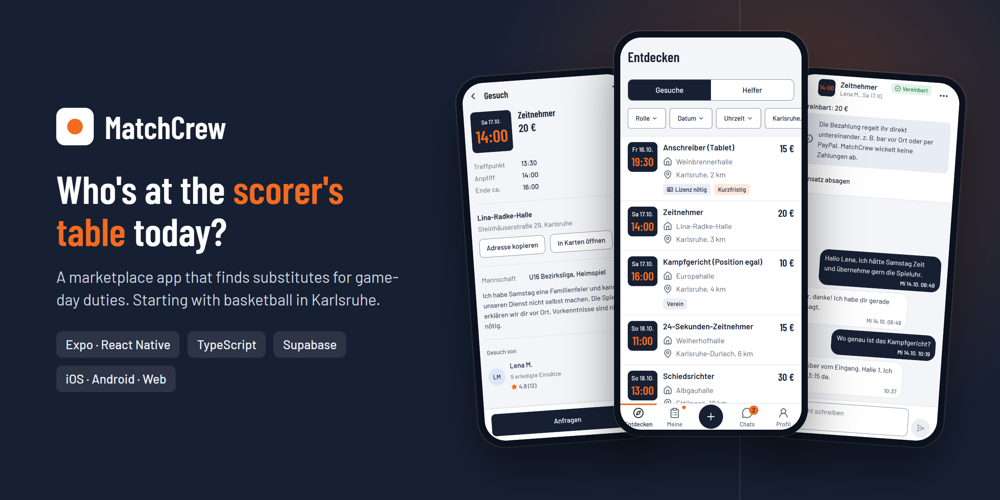
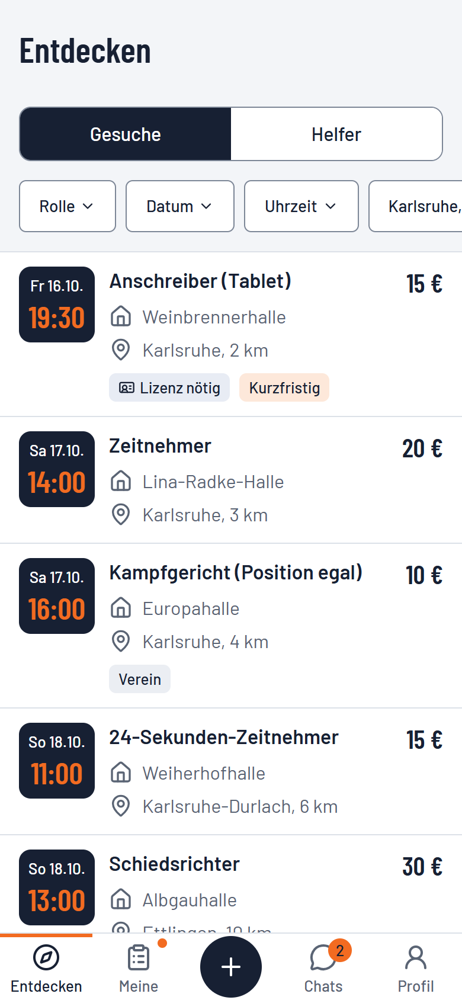
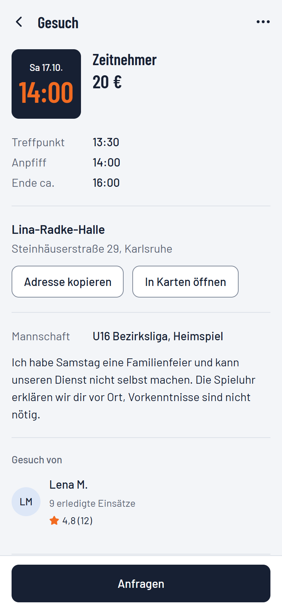
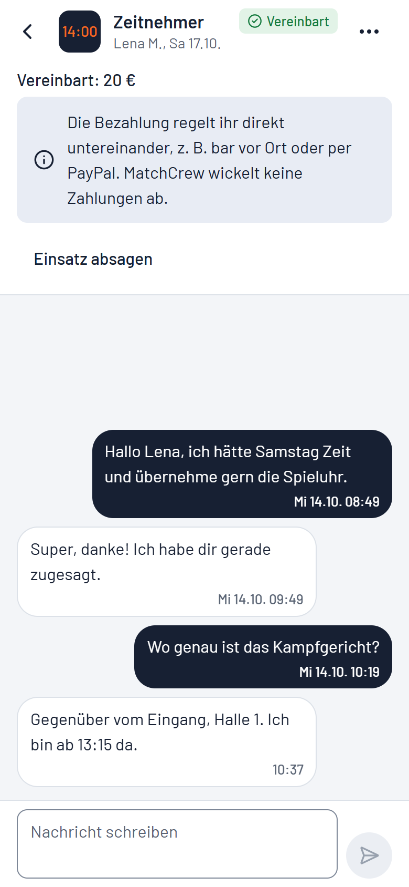
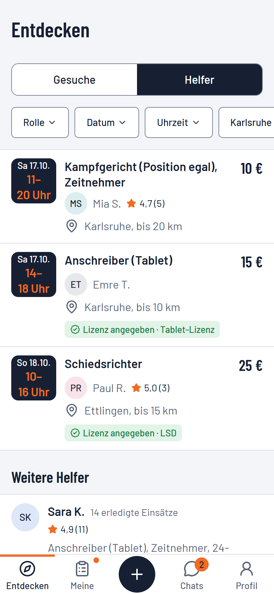
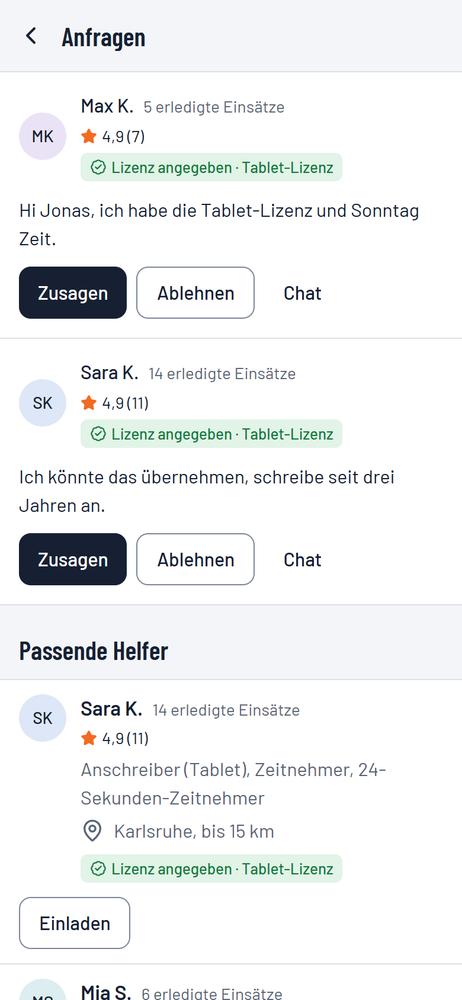
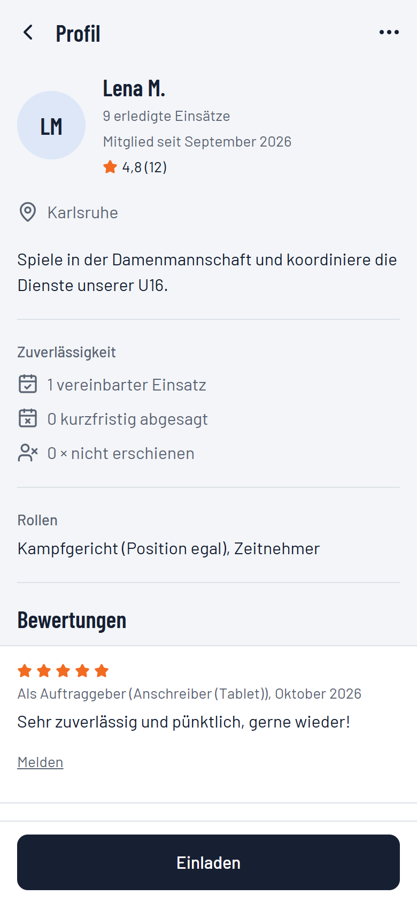
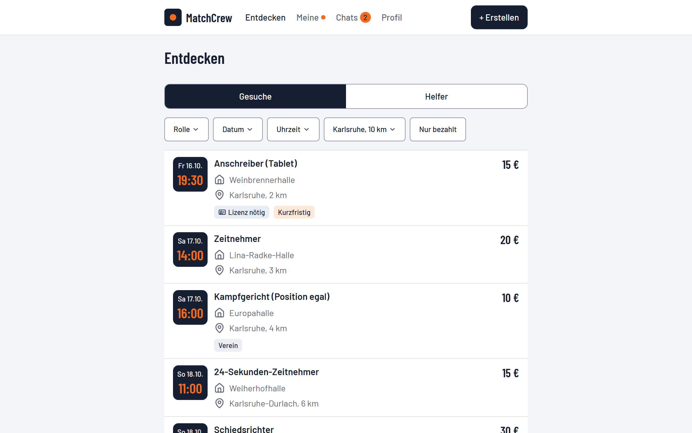
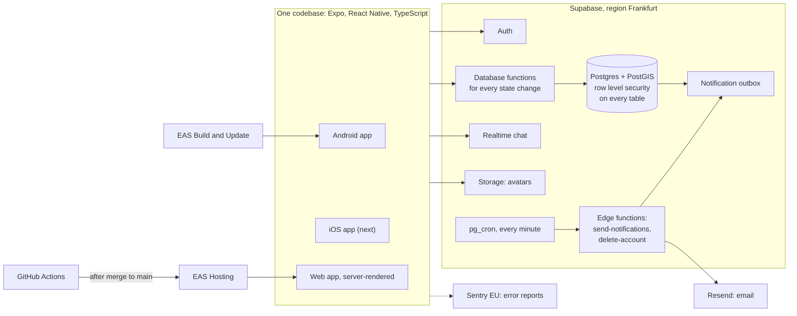

  

<h1 align="center">MatchCrew</h1>

  <b>A marketplace app that finds substitutes for game-day duties at the scorer's table. Starting with basketball in Karlsruhe.</b>

  <a href="https://adriannoahwimmer.github.io/matchcrew-demo/">Landing page</a> ·
  <a href="https://adriannoahwimmer.github.io/matchcrew-demo/#demo">Click demo</a> ·
  <a href="https://matchcrew.expo.app">Live web version</a> ·
  <a href="#screenshots">Screenshots</a> ·
  <a href="#architecture">Architecture</a>

  
  
  
  
  

> [!NOTE]
> This repository holds the public landing page, a small click demo and screenshots. The app itself is developed in a
> private repository. I am happy to walk you through the code on request.

## The problem

In German amateur basketball, every home game needs people at the scorer's table: a scorer on the tablet, a timekeeper
and a shot clock operator. Clubs hand these duties to their players and parents. Whoever can't make it starts asking
around in team chats.

MatchCrew turns this into a small marketplace:

1. **Post a request.** Role, hall, tip-off and price.
2. **Apply or invite.** Helpers nearby apply, or you invite someone whose availability fits your date.
3. **Agree and play.** After you accept, both sides get reminders and rate each other after the game. Payment stays
   between the two of you, for example cash at the hall or PayPal.

Helpers are students, young players and licensed officials who want to earn some money on the weekend.
Minors are part of the target group, so safety and privacy are built in from the start.

## Screenshots

Current web version with made-up demo data. The UI is in German.

<table>
  <tr>
    <td width="33%" align="center"> <b>Discover</b>: open requests nearby, filter by role, date, time, radius and price</td>
    <td width="33%" align="center"> <b>Request</b>: meeting time, hall, team and who is asking</td>
    <td width="33%" align="center"> <b>Chat</b>: realtime chat per assignment with status and agreed price</td>
  </tr>
  <tr>
    <td width="33%" align="center"> <b>Helpers</b>: availability offers and a helper directory</td>
    <td width="33%" align="center"> <b>Applications</b>: accept, decline or invite matching helpers</td>
    <td width="33%" align="center"> <b>Profile</b>: ratings and reliability instead of anonymous names</td>
  </tr>
</table>

   
  The same codebase runs as a server-rendered web app with a desktop layout.

## What works today

All features of the MVP scope are implemented, except push notifications.

| Area | What it does |
|---|---|
| Accounts | Sign-up with email and password, email verification code, onboarding for people and clubs, terms consent with versioning |
| Requests | Create, edit and cancel requests; roles with license levels (for example the tablet license for scorers) |
| Discover | Search open requests within a radius, filters for role, date, time and paid only, cursor-based paging |
| Offers and invitations | Helpers publish their availability; requesters invite them to a matching request with a proposed price |
| Helper directory | Find people who list themselves as helpers, nearest first |
| Applications and chat | Apply with a message, realtime chat per assignment, accept or decline, safety notice in the first chat |
| Assignments | Reminders, cancellation with reason, completion, "did not show up" |
| Trust | Mutual star ratings, published once both sides rated or the 14-day window closed, plus reliability counts for late cancellations and no-shows |
| Safety | Report content, block users, moderation emails, display names as "first name + initial" |
| Notifications | Email via an outbox table and an edge function: new application, acceptance, bundled chat emails, reminders 24 h before, daily budget |
| Privacy and legal | Account deletion with all personal data, imprint, privacy policy, terms of use, community rules |
| Sharing | Server-rendered link previews for shared requests and offers, for example in WhatsApp |

## Status and roadmap

Development started on 1 October 2026. Every package is one pull request that I test on a real Android phone before
it is merged.

| Package | Content | Status |
|---|---|---|
| MVP features | Accounts, requests, discover, offers, directory, chat, assignments, ratings, reports, legal texts | done |
| Safety net | Web build with server rendering in CI, database type check, route types, error pages, more tests | done |
| Email notifications | Outbox, edge function, reminders, chat digest, daily budget | done |
| Build foundation | EAS build profiles, app ID, over-the-air updates with fingerprinting, Sentry (EU) | done |
| Push notifications | Expo push, permission primer, deep links into the right screen | next |
| Production and closed test | Production database, production builds, closed test on Google Play with 12+ testers for 14 days | next |
| Release | Android and web, then iOS | planned |

## Architecture

### Tech stack

| Layer | Choice |
|---|---|
| App | Expo SDK 57, React Native, Expo Router, TypeScript (strict), react-native-web |
| UI | NativeWind, own design system with tokens, Barlow and Barlow Condensed |
| Forms and data | react-hook-form with Zod, TanStack Query |
| Backend | Supabase: Postgres with PostGIS, Auth, Realtime, Storage, Edge Functions (Deno), pg_cron |
| Email | Resend with an own sending domain |
| Build and delivery | EAS Build, EAS Update, EAS Hosting, GitHub Actions |
| Monitoring | Sentry (EU region) for app and web |
| Tests | Jest with Testing Library, pgTAP for the database, Deno tests for edge functions |

### Engineering principles

- **Security lives in the database.** Row level security is enabled on every table, and every policy has a test for
  allowed and for forbidden access. Status changes (request, application, assignment, review) only happen through
  database functions; clients have no update rights on status columns. Public reads without login go through
  dedicated functions that never return private fields.
- **Privacy by design.** Data stays in EU regions. Last names, birth dates, license numbers and email addresses never
  appear in public responses. Every table with personal data is part of a written deletion concept and of the account
  deletion function, with tests.
- **Docs first.** A product requirements document with feature IDs and business rules, a data model with state
  machines, a design system, UX flows as diagrams and 21 architecture decision records. Code changes that change
  behavior update the docs in the same pull request.
- **Accessible UI.** Labels on every interactive element, touch targets of at least 44 pt, WCAG AA contrast, and a
  loading, empty and error state on every screen.

### In numbers (as of 15 October 2026)

| | |
|---|---|
| Merged pull requests | 28 |
| Jest tests | 346 in 74 files |
| Database assertions (pgTAP) | 569 in 20 files |
| Edge function tests (Deno) | 29 |
| Database migrations | 36 |
| Architecture decision records | 21 |
| CI jobs per pull request | app checks, web build with server rendering, edge functions, database tests and type check |

## How it is built

MatchCrew is a solo project. I own the product: the idea, requirements and business rules, the architecture decisions,
the setup of all services, and the acceptance test of every package on a real device.

The code is written with **Claude Code** as an agentic coding tool, inside a fixed workflow:

1. Claude proposes a plan with affected feature IDs, files, migrations, policies and tests.
2. I approve or change the plan.
3. The feature is built as a vertical slice on its own branch: migration, row level security, database tests,
   database function, UI and UI tests.
4. The pull request contains a review section and a test guide. I test it on my Android phone.
5. It is merged only when CI is green. After the merge, CI publishes the web version and checks that it is live.

A `CLAUDE.md` file in the repository encodes the rules, for example: no new dependencies without asking, docs updated
in the same pull request, no secrets in code, and a list of non-negotiable database security rules.

## About

I'm Adrian, a master's student in Information Systems at the Karlsruhe Institute of Technology (KIT).
More projects on my [GitHub profile](https://github.com/adriannoahwimmer). Contact: adrian.noah.wimmer@gmail.com

<b>Kurzfassung auf Deutsch</b>

MatchCrew findet Ersatz für Spieltagsdienste am Kampfgericht, zum Start für Basketball in Karlsruhe. Wer einen Dienst
nicht selbst übernehmen kann, schreibt ihn als Gesuch aus. Helfer in der Nähe fragen an oder werden über ihr Angebot
eingeladen. Nach der Zusage werden beide erinnert und bewerten sich nach dem Spiel. Bezahlt wird direkt untereinander.

- **Stand:** Alle Funktionen des MVP sind umgesetzt, außer Push-Benachrichtigungen. Als Nächstes kommen Push, die
  Produktionsumgebung und ein geschlossener Test bei Google Play, danach der Release für Android und Web, dann iOS.
- **Technik:** Expo und React Native mit TypeScript für Android, iOS und Web aus einer Codebasis, Supabase in Frankfurt,
  Tests mit Jest und pgTAP, CI mit GitHub Actions.
- **Arbeitsweise:** Produkt, Anforderungen, Entscheidungen und Abnahme liegen bei mir; den Code schreibt Claude Code
  in einem festen Ablauf aus Plan, Freigabe, Pull Request, Test auf dem Handy und Merge bei grünem CI.
- **Ausprobieren:** [Landingpage mit Klick-Demo](https://adriannoahwimmer.github.io/matchcrew-demo/) und
  [Web-Version](https://matchcrew.expo.app) (Testumgebung).

---

Fonts: [Barlow](https://github.com/jpt/barlow), SIL Open Font License 1.1 (`fonts/OFL.txt`) ·
[Impressum und Datenschutz](https://adriannoahwimmer.github.io/matchcrew-demo/impressum.html)
